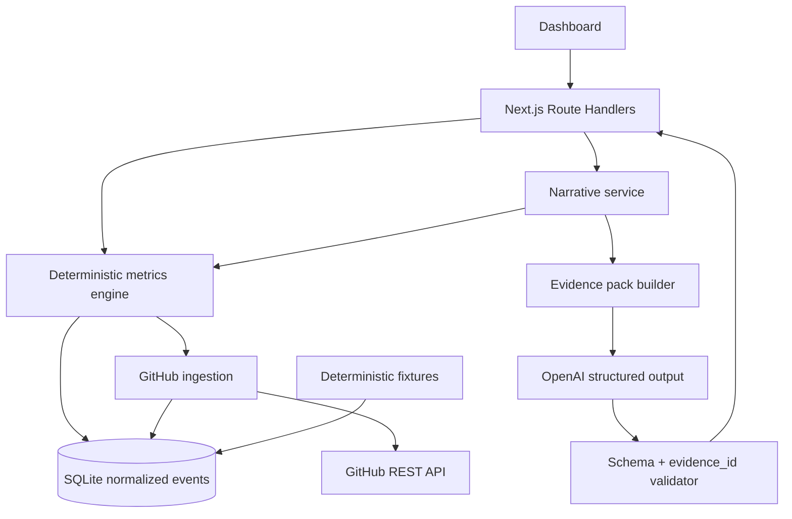

# Architecture

## Boundaries

| Module | Responsibility |
|---|---|
| `github.ts` | HTTP, pagination, ETag, normalize to domain types |
| `ingest.ts` | Cache freshness, fixture vs live seed |
| `db.ts` | SQLite persistence of raw normalized events |
| `metrics.ts` | Windowed aggregation, evidence pack |
| `narrative.ts` | Hypothesis synthesis + validation |
| API routes | Validation, HTTP mapping only |

## Caching model

- Unit cached: normalized PRs and reviews for `owner/repo`
- Freshness: `CACHE_TTL_SECONDS` (default 900) using `sync_state.fetched_at`
- Optional conditional request on pulls collection via stored ETag
- Rankings are **not** cached; any date window recomputes from stored events

## Failure modes

| Failure | Behavior |
|---|---|
| Invalid owner/repo/dates | 400 |
| Missing fixture / GitHub 404 | 404/502 |
| Rate limit | 502 with remaining hint |
| LLM missing/malformed/bad evidence ids | 422/502; metrics endpoint unaffected |
